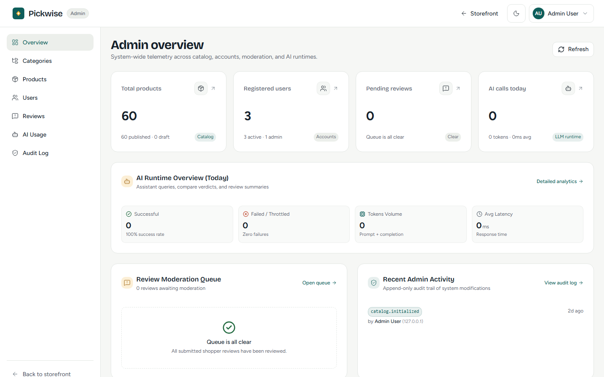

<div align="center">

# Pickwise

**An AI-powered shopping decision platform.**

Search a structured catalog, compare products side by side, and ask an AI assistant
that turns *"I need a laptop for video editing under ₹90,000"* into a short list of
grounded picks — with honest reasons and trade-offs.

[](https://github.com/meetsojitra08/pickwise/actions/workflows/ci.yml)
[](./LICENSE)
[](https://www.php.net/)
[](https://laravel.com/)
[](https://reactjs.org/)

</div>

---

## Screenshots

| Home — AI hero | Catalog & filters |
|:-:|:-:|
|  |  |

| Product detail + AI review summary | Compare matrix + AI verdict |
|:-:|:-:|
|  |  |

| AI shopping assistant (dark) | Admin dashboard |
|:-:|:-:|
|  |  |

> Screenshots are taken at 1440 × 900 with the Docker demo stack running.
> See [`docs/screenshots/README.md`](docs/screenshots/README.md) for the full list.

---

## What it does

Pickwise is a **decision tool**, not a shop. Every page ends with an outbound
"View on store" link. No cart. No payments.

| Feature | Description |
|---------|-------------|
| 🔍 **Catalog search** | Full-text search, typo-tolerance via `pg_trgm`, and faceted filters (price, category, brand, rating, structured specs) |
| ⚖️ **Value Score** | Transparent formula combining price, specs and rating — shown on every card and filterable |
| 📊 **Price history** | Interactive chart of price changes over time |
| 🤖 **AI shopping assistant** | Natural-language budget-aware picks grounded strictly in real database products (never hallucinated) |
| 🧠 **AI review summary** | Groq-powered pros/cons/themes per product, generated once and cached — zero latency on page load |
| 🆚 **AI compare verdict** | Select 2–4 products, get a structured verdict: strengths, weaknesses, and a plain-language recommendation |
| ❤️ **Wishlist** | Optimistic toggle, persisted to your account |
| 💾 **Saved comparisons** | Save and share comparison views via a public token |
| 🧑‍💼 **Admin panel** | Full catalog CRUD, review moderation queue, user management, AI usage analytics, append-only audit log |
| 🌙 **Dark mode** | Full dark theme with WCAG 2.2 AA contrast across every screen |
| ♿ **Accessibility** | Keyboard-navigable, screen-reader annotated, skip links, ARIA landmarks |

---

## Architecture

```
┌────────────────────────────────────┐
│   Browser  (React SPA)             │
│   Vite · TypeScript · Tailwind     │
│   shadcn/ui · TanStack Query       │
└──────────────┬─────────────────────┘
               │  HTTPS  (cookie auth, JSON)
┌──────────────▼─────────────────────┐
│   Nginx  (reverse proxy)           │
│   /       → React SPA              │
│   /api    → Laravel API            │
│   /storage → uploaded images       │
└──────────────┬─────────────────────┘
               │
┌──────────────▼─────────────────────────────────────────┐
│                  Laravel 13  REST API                  │
│  Routes → Middleware → Controller → FormRequest        │
│         → Action / Service → Eloquent → Resource       │
│                                                        │
│  AI flow:  DB products → Prompt → Groq → Validate IDs  │
└──────┬────────────────────────┬───────────────────────┘
       │                        │
┌──────▼──────────┐   ┌─────────▼──────────┐
│   PostgreSQL    │   │    Groq  API        │
│  tsvector FTS   │   │  (server-side only) │
│  pg_trgm typos  │   └────────────────────┘
└─────────────────┘
┌─────────────────┐
│     Redis       │
│  cache · queue  │
│  sessions · AI  │
│  rate limits    │
└─────────────────┘
```

### Request → response flow (catalog search)

```
GET /api/v1/products?q=gaming+mouse&max_price=3000&sort=rating_desc
  → ThrottleMiddleware (120 req/min)
  → ProductController::index
  → ProductSearchQuery (tsvector + pg_trgm, filters, eager loads)
  → facets served from Redis cache (TTL 5 min, busted by ProductObserver)
  → ProductCollection resource
  → JSON envelope  { data: [...], meta: { total, per_page, ... } }
```

### AI assistant flow

```
POST /api/v1/assistant/conversations/{id}/messages  { message, budget_max }
  → ai-quota middleware  (Redis counter, daily limit)
  → AssistantService
      1. ProductSearchQuery  → up to 12 real DB products
      2. Build grounded prompt (products + user message + preferences)
      3. POST Groq  (JSON mode, 20 s timeout, 1 retry)
      4. Validate: every recommended id was in our list, prices ≤ budget
      5. Fallback to deterministic results if Groq fails
  → AiQuotaService::consume()  (only on Ok status — failures don't cost quota)
  → AiUsageLogger::log()
  → AssistantMessageResource  → SPA shows grounded recommendation cards
```

---

## AI design notes

### Why the AI only sees products from our database

Every AI call in Pickwise is **database-grounded**: the assistant is given a filtered
list of real products (up to 12) and may only recommend IDs from that list. The LLM
never names a product we did not supply.

This design decision solves three problems at once:

1. **Hallucination prevention** — The model cannot invent products, prices or specs.
   Every card the UI renders comes from a database row.
2. **Budget enforcement in code, not in the prompt** — After the LLM replies, the
   service validates that every recommended product's price is within the user's
   budget. If the LLM ignores the budget (it sometimes does), the code catches it.
3. **Explainability** — The recommended products are real rows; every field shown to
   the user (price, rating, specs) is fetched from the database, not taken from the
   AI's text. The AI only contributes the *reasoning* ("why it fits").

### Quota protection (Redis daily counter)

Each user (or guest session) gets a daily AI call limit enforced by a Redis counter
(`pickwise:ai:quota:{user|session|ip}:{YYYY-MM-DD}`, TTL to next UTC midnight).
The counter is **only incremented on a successful AI reply** — provider failures,
invalid JSON, and fallback paths do not cost quota. This prevents double-charging
users for Groq outages.

### Review summaries — queued, not on-demand

AI review summaries are generated once by a queued Laravel job
(`GenerateReviewSummary`) whenever the set of approved reviews changes. The product
detail page reads the saved row from `review_summaries`; it never calls Groq during
a page load. This keeps p99 latency flat even when Groq is slow.

### The Verdict panel — one consistent AI surface

All three AI outputs (assistant picks, compare verdict, review summary) surface
through one shared component: `VerdictPanel`. It has a Marigold left-rule accent,
a structured layout (fit meter, "why it fits", trade-offs), and six states: idle,
loading skeleton, ready, fallback (deterministic results with a notice), error with
retry, and daily quota exceeded. Using one component ensures the AI "feel" is
consistent and learnable.

### Groq failure modes and graceful degradation

| Failure | Behaviour |
|---------|-----------|
| Network / connection error | Retry once with 1 s back-off, then `AiUnavailableException` → `503 ai_unavailable` |
| 4xx (bad key, model not found) | No retry; throw immediately |
| Invalid JSON in reply | Retry once; if still invalid, throw |
| All exceptions in assistant | Fall back to deterministic `ProductSearchQuery` results with a `fallback` status flag |
| All exceptions in compare / summary | Propagate `503`; UI shows `ErrorState` with retry |

---

## Tech stack

| Layer | Technology |
|-------|-----------|
| Backend | **Laravel 13** — REST API, auth, queues, jobs |
| Frontend | **React 19** + **TypeScript** + **Vite** |
| UI components | **shadcn/ui** (owned, accessible component source) |
| Styling | **Tailwind CSS** + CSS custom-property design tokens |
| Database | **PostgreSQL 16** — `tsvector` FTS, `pg_trgm`, composite indexes |
| Cache / queue / sessions / rate limits | **Redis 7** (phpredis extension) |
| AI inference | **Groq API** (server-side only, JSON mode) |
| Environment | **Docker** + Docker Compose |
| Backend tests | **Pest** + **Larastan** (level 6) + **Laravel Pint** |
| Frontend tests | **Vitest** + **Testing Library** + **Playwright** (E2E) |
| CI | **GitHub Actions** (lint → analyse → test → build → audit) |

---

## Local setup

### Prerequisites

- Docker Desktop (or Docker Engine + Compose plugin)
- A free [Groq API key](https://console.groq.com/) and a current model ID

### 1 — Clone and configure

```bash
git clone https://github.com/meetsojitra08/pickwise.git
cd pickwise
cp backend/.env.example backend/.env
```

Edit `backend/.env` and fill in:

```env
GROQ_API_KEY=gsk_...          # your Groq API key
GROQ_MODEL=llama-3.3-70b-versatile   # check https://console.groq.com/docs/models
```

> All other values (`DB_*`, `REDIS_*`, `APP_KEY`) are pre-set for the local Docker
> environment. `APP_KEY` is generated in the next step.

### 2 — Build and start

```bash
docker compose up -d --build
```

This starts eight services: `nginx` (port **8080**), `app` (PHP-FPM), `queue`
(worker), `scheduler`, `db` (PostgreSQL), `redis`, `web` (Vite HMR on **5173**),
and `mailpit` (**8025**).

### 3 — Initialise the database

```bash
# Generate app key, run all migrations, and seed the demo catalog
docker compose exec app php artisan key:generate
docker compose exec app php artisan migrate:fresh --seed
```

The seeder creates:
- 6 categories, ~18 brands, ~60 products with specs and price history
- Realistic reviews (mixed sentiment) so AI summary jobs run
- A demo customer (`customer@pickwise.test` / `password`) and admin
  (`admin@pickwise.test` / `password`)

### 4 — Open the app

| URL | What you see |
|-----|-------------|
| `http://localhost:8080` | Pickwise SPA |
| `http://localhost:8080/admin` | Admin panel (login as admin) |
| `http://localhost:5173` | Vite dev server with HMR |
| `http://localhost:8025` | Mailpit (local mail) |

---

## Running tests

```bash
# Backend (inside the app container — host PHP may lack the redis extension)
docker compose exec app php artisan test

# Backend lint + static analysis (host PHP is fine for these)
cd backend
./vendor/bin/pint --test    # formatting
./vendor/bin/phpstan analyse # Larastan level 6

# Frontend
cd frontend
npm run lint        # ESLint
npm run typecheck   # tsc --noEmit
npm run test        # Vitest (unit + component)
npm run test:e2e    # Playwright E2E (requires Docker stack running)
```

---

## Project structure

```
pickwise/
├── LICENSE
├── README.md
├── docker-compose.yml
├── .github/workflows/ci.yml
├── docker/
│   ├── nginx/default.conf      # Reverse proxy + security headers + CSP
│   ├── php/Dockerfile          # PHP-FPM 8.3, phpredis, expose_php=Off
│   └── node/Dockerfile
├── docs/                       # Architecture, schema, API spec, UI guide
│   ├── openapi.yaml / .json    # Full OpenAPI 3.1.0 specification (49 paths)
│   ├── screenshots/            # README screenshots
│   └── feature-specs/          # 13 detailed feature specs
├── backend/                    # Laravel 13 application
│   ├── app/
│   │   ├── AI/                 # GroqClient, AssistantService, CompareService, ReviewSummaryService
│   │   ├── Actions/            # Single-purpose use-cases
│   │   ├── Http/Controllers/Api/V1/{Public,Customer,Admin}/
│   │   ├── Services/           # AuditLogger, ValueScoreCalculator, AiQuotaService
│   │   └── ...
│   └── tests/{Feature,Unit,AI}/
└── frontend/                   # React SPA
    └── src/
        ├── features/           # auth, catalog, product, compare, assistant, wishlist, account, admin
        ├── components/shared/  # VerdictPanel, ErrorState, AiMark, ...
        └── test/               # accessibility, dark-mode, responsive, e2e suites
```

---

## API documentation

The full **OpenAPI 3.1.0** specification lives at [`docs/openapi.yaml`](docs/openapi.yaml)
(and [`docs/openapi.json`](docs/openapi.json)).

It documents **49 path templates** (73 Laravel routes) across 17 tags, 63 schemas,
and 3 security schemes (Sanctum session cookie, CSRF header, guest session key).

To browse it interactively, paste the YAML into [editor.swagger.io](https://editor.swagger.io).

---

## Decisions & learnings

Detailed architectural decisions live in [`docs/decisions.md`](docs/decisions.md).
The step-by-step build history (what was built and what was learned at each step)
lives in [`docs/progress-tracker.md`](docs/progress-tracker.md).

---

## License

[MIT](./LICENSE) © 2026 Meet Sojitra
