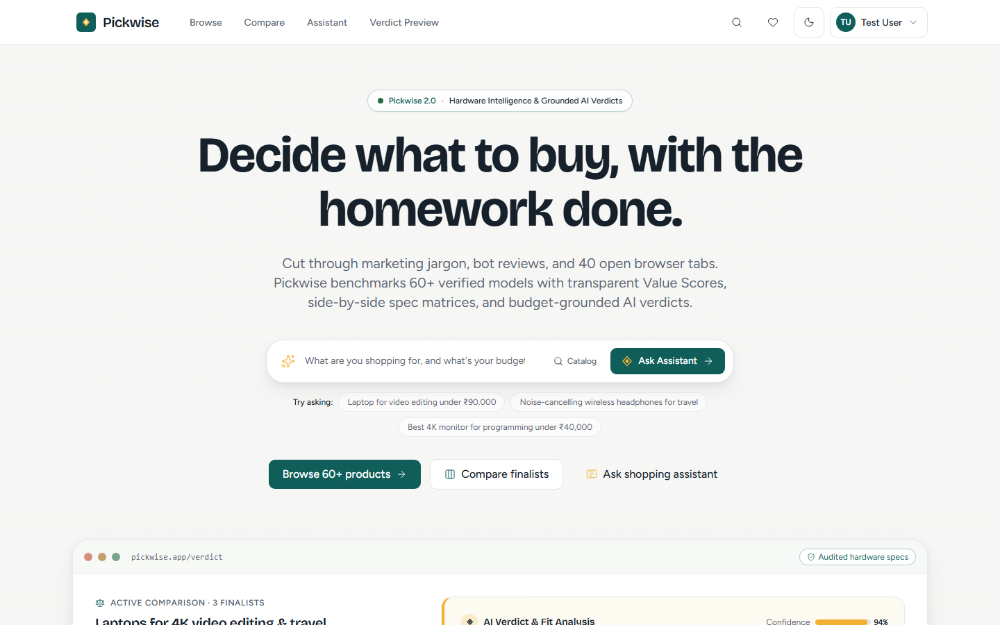
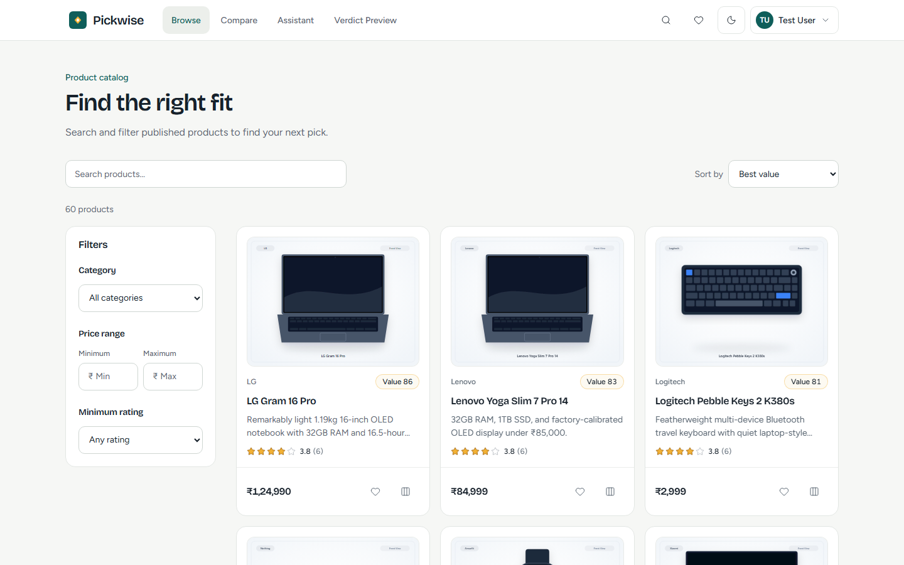
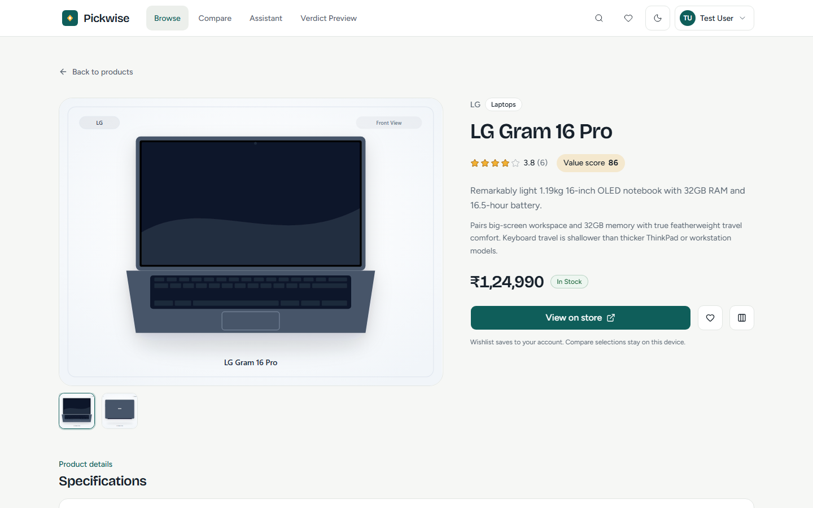
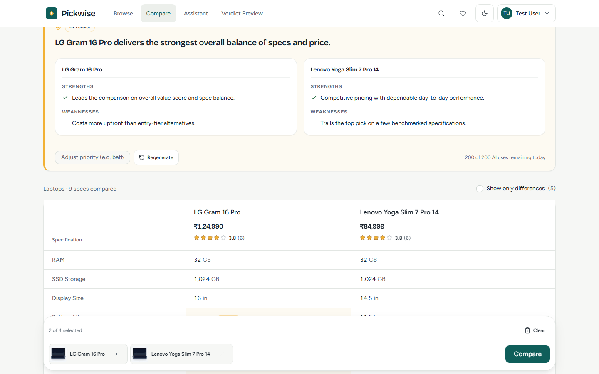
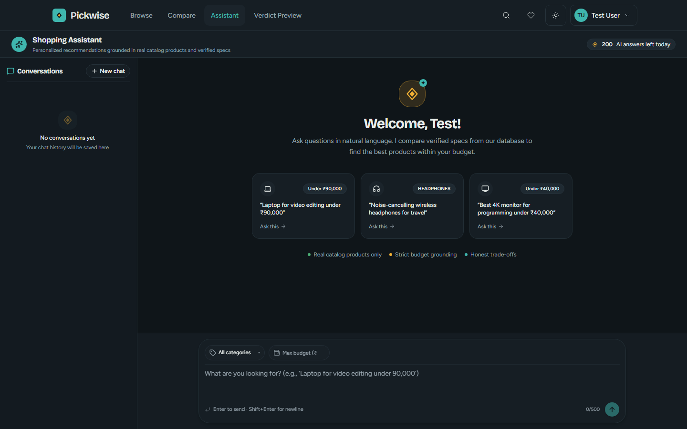

<div align="center">

# Pickwise

**An AI-powered shopping decision platform.**

Search a structured catalog, compare products side by side, and ask an AI assistant
that turns *"I need a laptop for video editing under ₹90,000"* into a short list of
grounded picks — with honest reasons and trade-offs.

[](https://github.com/meetsojitra08/pickwise/actions/workflows/ci.yml)
[](https://pickwise-api-f5fx.onrender.com/docs)
[](./LICENSE)
[](https://www.python.org/)
[](https://fastapi.tiangolo.com/)
[](https://reactjs.org/)

</div>

---

## Screenshots

| Home — AI hero | Catalog & filters |
|:-:|:-:|
|  |  |

| Product detail + AI review summary | Compare matrix + AI verdict |
|:-:|:-:|
|  |  |

| AI shopping assistant (dark) | Admin dashboard |
|:-:|:-:|
|  |  |

> Screenshots are taken at 1440 × 900 with the Docker demo stack running.
> See [`docs/screenshots/README.md`](docs/screenshots/README.md) for the full list.

---

## Live demo

The Pickwise backend is deployed live on **Render** with **Neon PostgreSQL** and **Upstash Redis**:

- 🌐 **Live API Base:** [`https://pickwise-api-f5fx.onrender.com`](https://pickwise-api-f5fx.onrender.com)
- 📖 **Interactive Swagger UI:** [`https://pickwise-api-f5fx.onrender.com/docs`](https://pickwise-api-f5fx.onrender.com/docs)
- 📑 **Interactive ReDoc:** [`https://pickwise-api-f5fx.onrender.com/redoc`](https://pickwise-api-f5fx.onrender.com/redoc)
- 🩺 **Health Check:** [`https://pickwise-api-f5fx.onrender.com/up`](https://pickwise-api-f5fx.onrender.com/up)
- 🛍️ **Seeded Products API:** [`https://pickwise-api-f5fx.onrender.com/api/v1/products`](https://pickwise-api-f5fx.onrender.com/api/v1/products)

---

## What it does

Pickwise is a **decision tool**, not a shop. Every page ends with an outbound
"View on store" link. No cart. No payments.

| Feature | Description |
|---------|-------------|
| 🔍 **Catalog search** | Full-text search, typo-tolerance via `pg_trgm`, and faceted filters (price, category, brand, rating, structured specs) |
| ⚖️ **Value Score** | Transparent formula combining price, specs and rating — shown on every card and filterable |
| 📊 **Price history** | Interactive chart of price changes over time (180 days) |
| 🤖 **AI shopping assistant** | Natural-language budget-aware picks grounded strictly in real database products (never hallucinated) |
| 🧠 **AI review summary** | Groq-powered pros/cons/themes per product, generated once and cached — zero latency on page load |
| 🆚 **AI compare verdict** | Select 2–4 products, get a structured verdict: strengths, weaknesses, and a plain-language recommendation |
| ❤️ **Wishlist** | Optimistic toggle, persisted to your account |
| 💾 **Saved comparisons** | Save and share comparison views via a public token |
| 🧑‍💼 **Admin panel** | Full catalog CRUD, review moderation queue, user management, AI usage analytics, append-only audit log |
| 🌙 **Dark mode** | Full dark theme with WCAG 2.2 AA contrast across every screen |
| ♿ **Accessibility** | Keyboard-navigable, screen-reader annotated, skip links, ARIA landmarks |

---

## Architecture

```
┌────────────────────────────────────┐
│   Browser  (React SPA)             │
│   React 19 · TypeScript · Tailwind │
│   shadcn/ui · TanStack Query       │
└──────────────┬─────────────────────┘
               │  HTTPS  (cookie auth, JSON)
┌──────────────▼─────────────────────┐
│   Nginx  (reverse proxy)           │
│   /       → React SPA              │
│   /api    → FastAPI ASGI App       │
│   /sanctum → CSRF compatibility    │
│   /storage → uploaded images       │
└──────────────┬─────────────────────┘
               │
┌──────────────▼─────────────────────────────────────────┐
│                   FastAPI REST API                     │
│  Routes → Middleware → Dependency Injection            │
│         → Service Layer → SQLAlchemy 2.0 (async)       │
│                                                        │
│  AI flow:  DB products → Prompt → Groq → Validate IDs  │
└──────┬────────────────────────┬───────────────────────┘
       │                        │
┌──────▼──────────┐   ┌─────────▼──────────┐
│   PostgreSQL    │   │    Groq  API        │
│  tsvector FTS   │   │  (server-side only) │
│  pg_trgm typos  │   └────────────────────┘
└─────────────────┘
┌─────────────────┐
│     Redis 7     │
│  cache · quota  │
│  session store  │
└─────────────────┘
```

### Request → response flow (catalog search)

```
GET /api/v1/products?q=gaming+mouse&max_price=3000&sort=rating_desc
  → RequestIdMiddleware (assigns X-Request-Id)
  → catalog.search_products (CatalogService)
  → PostgreSQL query (tsvector + pg_trgm fuzzy matching, dynamic spec filters)
  → Redis cache check for facet counts
  → PaginatedResponse[ProductCardOut]
  → JSON envelope  { data: [...], meta: { total, per_page, ... } }
```

### AI assistant flow

```
POST /api/v1/assistant/conversations/{id}/messages  { message, category? }
  → CsrfMiddleware (validates X-XSRF-TOKEN header against cookie)
  → AiQuotaService (checks Redis daily counter)
  → AssistantService:
      1. PostgreSQL query → candidate matching products in DB
      2. Grounded prompt with catalog candidate products
      3. Call Groq with JSON mode enabled (20s timeout, fallback on error)
      4. Database anti-hallucination check: ensure all recommended product IDs exist in DB
      5. Save message in ai_messages and log telemetry to ai_usage_logs
  → Consume quota counter on success
  → ApiResponse[AssistantMessageOut] → SPA displays grounded recommendation cards
```

---

## AI design notes

### Why the AI only sees products from our database

Every AI call in Pickwise is **database-grounded**: the assistant is given a filtered
list of real products and may only recommend IDs from that list. The LLM never names
a product we did not supply.

1. **Hallucination prevention** — The model cannot invent products, prices or specs.
   Every card the UI renders comes from a database row.
2. **Budget enforcement in code, not in the prompt** — After the LLM replies, the
   service validates that every recommended product's price is within the user's
   budget.
3. **Explainability** — The recommended products are real rows; every field shown to
   the user (price, rating, specs) is fetched from the database. The AI only contributes
   the *reasoning* ("why it fits").

### Quota protection (Redis daily counter)

Each user (or guest session) gets a daily AI call limit enforced by a Redis counter
(`ai:quota:{user_or_session}:{YYYY-MM-DD}`, TTL to next UTC midnight).
The counter is **only incremented on a successful AI reply** — provider failures,
invalid JSON, and fallback paths do not cost quota.

### The Verdict panel — one consistent AI surface

All three AI outputs (assistant picks, compare verdict, review summary) surface
through one shared component: `VerdictPanel`. It has a Marigold left-rule accent,
a structured layout (fit meter, "why it fits", trade-offs), and six states: idle,
loading skeleton, ready, fallback, error with retry, and daily quota exceeded.

---

## Tech stack

| Layer | Technology | Role & Architecture |
|-------|-----------|---------------------|
| Backend API | **FastAPI (Python 3.12+)** | REST API, async I/O, background tasks, cookie auth, CSRF protection |
| ORM & Validation | **SQLAlchemy 2.0 (async)** + **Pydantic v2** + **asyncpg** | Type-safe schema validation, async PostgreSQL engine |
| Frontend | **React 19** + **TypeScript** + **Vite** | Single Page Application with TanStack Query and React Hook Form |
| UI & Design | **shadcn/ui** + **Tailwind CSS** | Accessible component source, design tokens, light/dark themes |
| Primary Database | **PostgreSQL 17** (Local Docker & **Neon Cloud**) | `tsvector` full-text search, `pg_trgm` fuzzy matching, GIN indexes |
| Cache & Quotas | **Redis 7** (Local Docker & **Upstash Serverless**) | Session storage, token invalidation, sliding daily AI limits |
| Cloud Hosting | **Render** | Production Web Service with automatic git-push CI/CD and health checks |
| AI Inference | **Groq API** (`qwen/qwen3.8-27b`) | Sub-second (~350ms) inference with database-grounded prompts |
| Containerization | **Docker** + Docker Compose | Fully reproducible local dev & multi-stage production images |
| Test Suites | **pytest** (backend) + **Vitest / Playwright** (frontend) | 20 Pytest async suites + 308 Vitest component tests |

---

## Local setup

### Prerequisites

- Docker Desktop (or Docker Engine + Compose plugin)
- A free [Groq API key](https://console.groq.com/)

### 1 — Clone and configure

```bash
git clone https://github.com/meetsojitra08/pickwise.git
cd pickwise
```

Set `GROQ_API_KEY` in `docker-compose.yml` or your `.env` file:

```env
GROQ_API_KEY=gsk_...
```

### 2 — Build and start

```bash
docker compose up -d --build
```

This starts six services: `nginx` (port **8080**), `app` (FastAPI Uvicorn ASGI on **8000**),
`db` (PostgreSQL 17), `redis` (Redis 7), `web` (React Vite dev server on **5173**),
and `mailpit` (**8025**).

### 3 — Initialise the database & seed demo data

```bash
# Seed 6 categories, 21 brands, 60 products with specs, 180-day price curves, and test users
docker compose exec app python -m app.db.seed
```

Demo accounts:
- **Admin:** `admin@pickwise.test` / `password`
- **Shopper:** `customer@pickwise.test` / `password`

### 4 — Open the app

| URL | What you see |
|-----|-------------|
| `http://localhost:8080` | Pickwise Storefront |
| `http://localhost:8080/admin` | Admin panel |
| `http://localhost:8000/docs` | Interactive Swagger API documentation |
| `http://localhost:8000/redoc` | Interactive ReDoc API documentation |
| `http://localhost:5173` | Vite dev server |
| `http://localhost:8025` | Mailpit (local mail) |

---

## Running tests

```bash
# Backend integration test suite (20 test suites)
docker compose exec app pytest tests/

# Frontend unit & component test suite (308 tests)
docker compose exec web npm test

# Frontend production typecheck & build
docker compose exec web npm run build
```

---

## Project structure

```
pickwise/
├── LICENSE
├── README.md
├── docker-compose.yml
├── docker/
│   ├── nginx/default.conf       # Reverse proxy + security headers + CSP
│   ├── fastapi/Dockerfile       # Python 3.12-slim ASGI Dockerfile
│   └── node/Dockerfile          # Node.js container for React 19
├── docs/                        # Architecture, schema, API spec, UI guide
│   ├── openapi.yaml / .json     # Full OpenAPI 3.1.0 specification
│   ├── screenshots/             # README screenshots
│   └── feature-specs/           # 13 detailed feature specs
├── backend/                     # FastAPI Application
│   ├── app/
│   │   ├── main.py              # Application entrypoint & CORS middleware
│   │   ├── core/                # Config, security, auth dependencies, middleware
│   │   ├── db/                  # Session, init_db, seed data
│   │   ├── models/              # SQLAlchemy 2.0 async models
│   │   ├── schemas/             # Pydantic v2 request & response schemas
│   │   ├── services/            # Catalog, value score, assistant, groq client, admin
│   │   └── api/v1/              # Versioned API routes
│   ├── tests/                   # Pytest async test suite
│   ├── pyproject.toml           # Python dependencies and pytest configuration
│   └── requirements.txt         # Pinned requirements
└── frontend/                    # React SPA
    └── src/
        ├── features/            # auth, catalog, product, compare, assistant, wishlist, account, admin
        ├── components/shared/   # VerdictPanel, ErrorState, AiMark, ...
        └── test/                # accessibility, dark-mode, responsive test suites
```

---

## API documentation

- **Interactive Swagger UI:** Visit `http://localhost:8000/docs`
- **Interactive ReDoc:** Visit `http://localhost:8000/redoc`
- **OpenAPI 3.1.0 Static Files:** [`docs/openapi.yaml`](docs/openapi.yaml) and [`docs/openapi.json`](docs/openapi.json)

---

## Deployment

Pickwise backend is production-ready for deployment on **Render**:

- **Render Deployment Guide:** [`docs/deployment-render.md`](docs/deployment-render.md)
- **Production Dockerfile:** [`docker/fastapi/Dockerfile.prod`](docker/fastapi/Dockerfile.prod)
- **Infrastructure Blueprint:** [`render.yaml`](render.yaml)

---

## License

[MIT](./LICENSE) © 2026 Meet Sojitra
